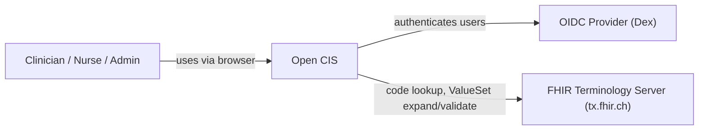
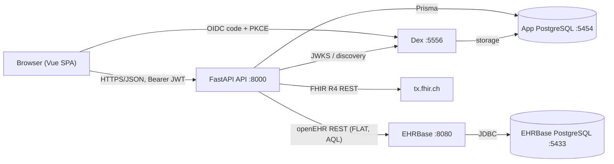
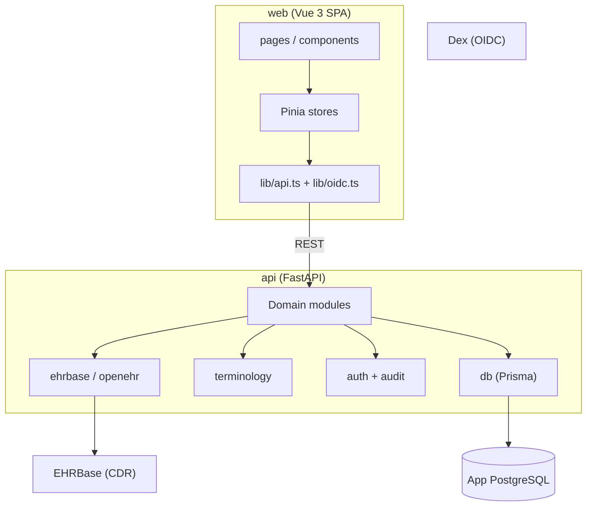
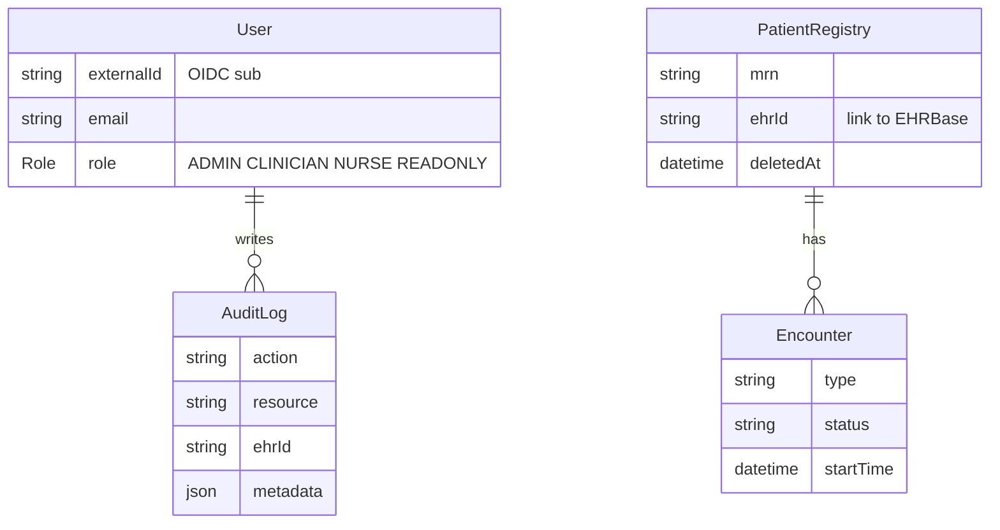
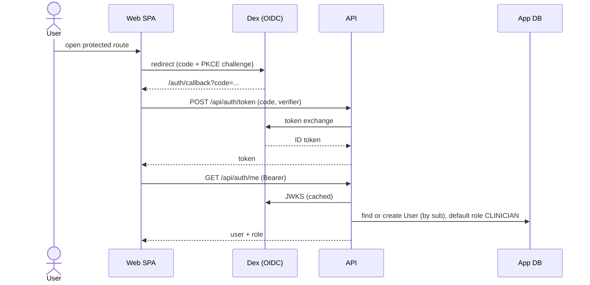
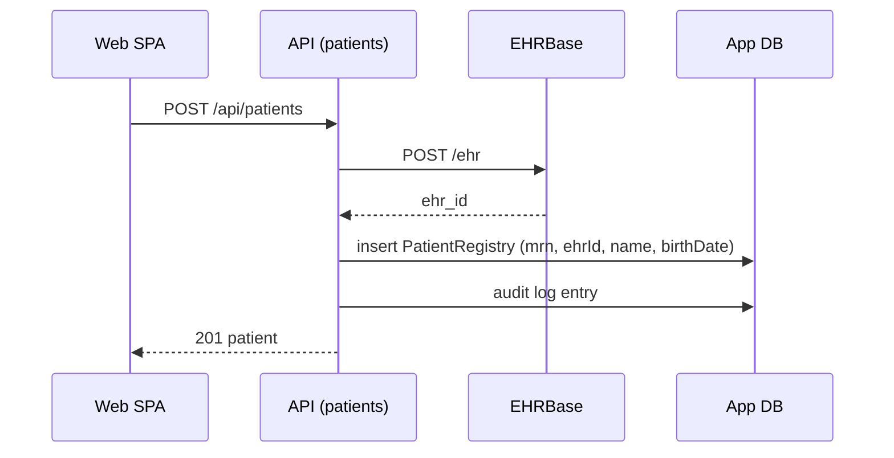
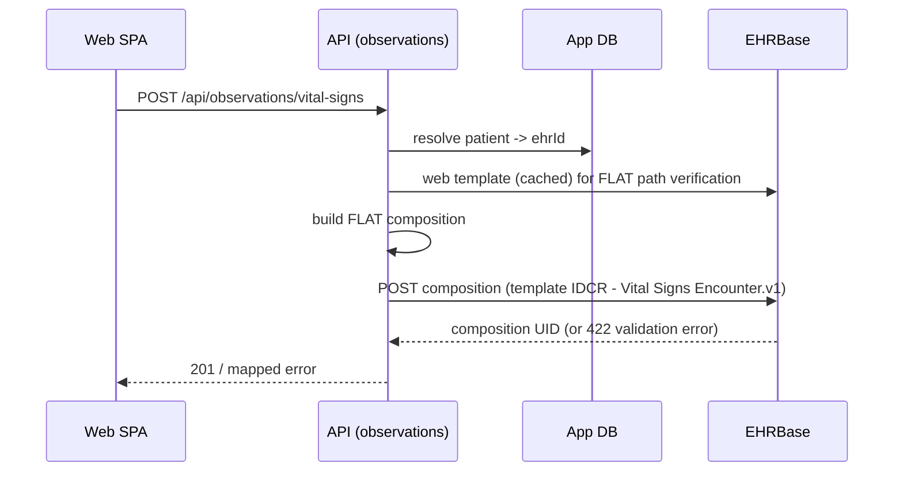
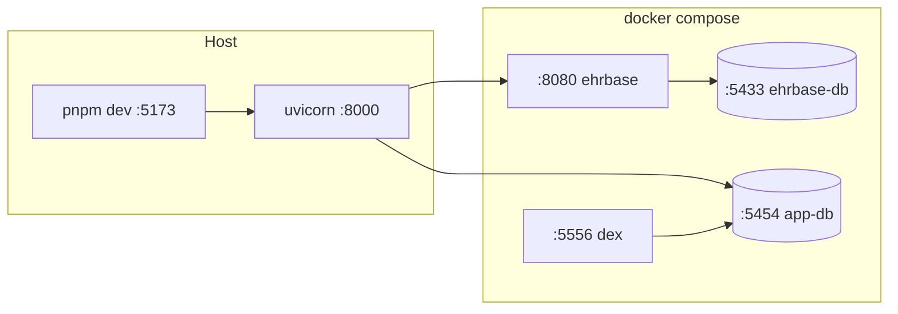
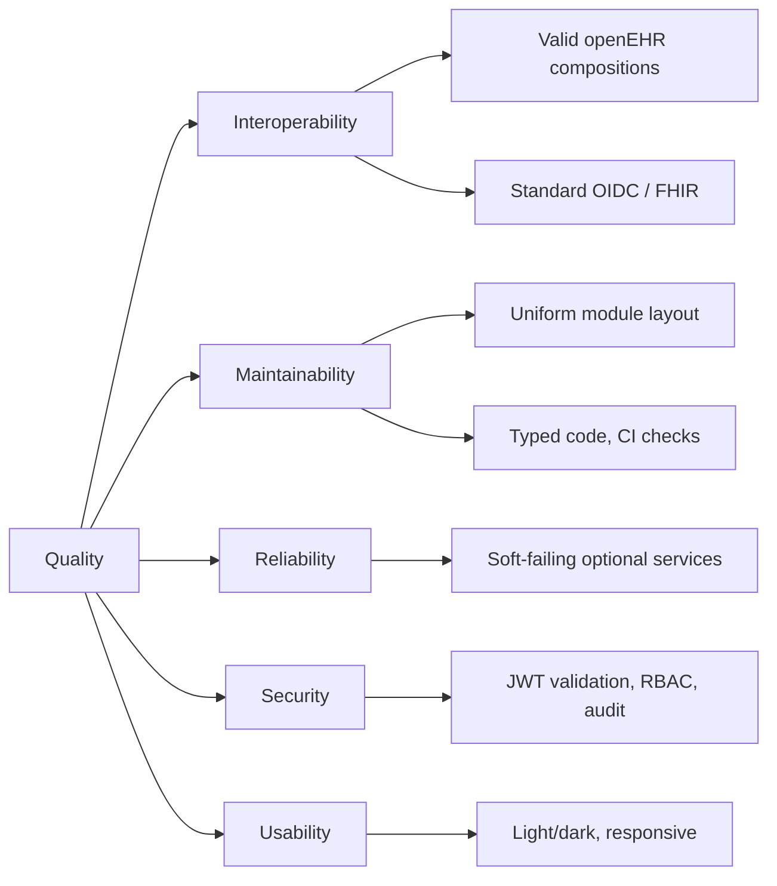

# Architecture Documentation (arc42)

This document describes the architecture of Open CIS following the [arc42](https://arc42.org) template (version 8). It is the entry point for architecture documentation; details on individual decisions live in the [ADRs](../decisions/0001-use-openehr.md) and the [PRDs](https://github.com/platzhersh/open-cis/tree/main/docs/prd).

!!! note
    Open CIS is a personal learning project, not a certified medical product. Sections on quality and risks reflect that scope.

---

## 1. Introduction and Goals

### 1.1 Requirements Overview

Open CIS is a minimal Clinical Information System (CIS) built on [openEHR](https://openehr.org) and [EHRBase](https://ehrbase.org). It is used to explore modern, standards-based clinical data architecture.

| Capability | Description | Reference |
|---|---|---|
| Patient management | Create, search, update and soft-delete patients; each patient is linked to one EHR | PRD-0002 |
| Encounters | Record and manage patient encounters (ambulatory, emergency, inpatient, ...) | PRD-0003 |
| Vital signs | Record vital signs as openEHR compositions and chart them | PRD-0004 |
| CAVE / adverse reactions | Allergy and adverse-reaction list, including "no known allergies" | PRD-0006 |
| Medications | Medication orders per patient | `api/src/medications` |
| Terminology | FHIR R4 terminology lookup, validation and enrichment of coded values | PRD-0012 |
| Authentication & roles | OIDC login, role-based access control, audit log | ADR-0010 |
| System info | Version and health overview of all components | PRD-0009 |

### 1.2 Quality Goals

| Priority | Goal | Motivation |
|---|---|---|
| 1 | **Standards conformance** | Clinical data must be stored as valid openEHR compositions, queryable via AQL, independent of the application |
| 2 | **Learnability / simplicity** | Small, readable code base with a consistent module structure; the project exists to learn |
| 3 | **Separation of clinical and app data** | Clinical data in the CDR, application data in a separate database, so either can evolve independently |
| 4 | **Resilience to optional dependencies** | An unavailable terminology server must not block clinical reads |

### 1.3 Stakeholders

| Role | Expectations |
|---|---|
| Maintainer / author | Fast iteration, clear structure, documented decisions |
| Contributors | Easy local setup (`docker compose up`), conventions in `CLAUDE.md` |
| Readers of the blog series / docs site | Understandable reference for an openEHR-based application |
| Clinicians (simulated users) | Usable UI in light and dark mode, reliable data entry |

---

## 2. Architecture Constraints

| Constraint | Background |
|---|---|
| openEHR as clinical data model | ADR-0001; clinical content is modelled through archetypes and templates, not custom tables |
| EHRBase 2.x as the CDR | Provides the openEHR REST API and AQL; run as Docker image `ehrbase/ehrbase:2.0.0` |
| FLAT composition format | Compositions are built in EHRBase FLAT format; suffix rules depend on RM data type (see `CLAUDE.md`, ADR-0008, ADR-0009) |
| Python 3.11+, async only | All API functions are `async`, HTTP via `httpx.AsyncClient`, Prisma client with `interface = "asyncio"` |
| Strict typing | mypy for Python, TypeScript strict mode |
| Standard OIDC | No provider-specific code; Dex locally, swappable (ADR-0010) |
| Deployment on Railway | One `railway.toml` per service; Docker-based builds |
| Conventional Commits | Single monorepo version, releases automated from commit/PR titles (ADR-0006) |
| Light and dark UI | All UI must support both themes |

---

## 3. Context and Scope

### 3.1 Business Context

| Partner | Input / Output |
|---|---|
| Users (clinician, nurse, admin, read-only) | Enter and view patients, encounters, vitals, allergies, medications |
| OIDC provider | Issues ID tokens (Authorization Code + PKCE); publishes discovery document and JWKS |
| FHIR terminology server | Resolves display names for codes (e.g. SNOMED CT), expands and validates ValueSets. Default `https://tx.fhir.ch/r4`, configurable, can be disabled |

### 3.2 Technical Context

| Interface | Protocol / format | Notes |
|---|---|---|
| Browser → API | REST/JSON under `/api/*`, `Authorization: Bearer <JWT>` | CORS restricted via `CORS_ORIGINS` |
| Browser → OIDC | Authorization Code flow with PKCE | Implemented in `web/src/lib/oidc.ts`, `pkce.ts` |
| API → OIDC | HTTPS, discovery + JWKS (cached 1 h) | `OIDC_TOKEN_URL` / `OIDC_JWKS_URL` override for Railway private networking |
| API → EHRBase | openEHR REST API, FLAT JSON, AQL, ADL 1.4 templates (OPT) | Basic auth optional (`EHRBASE_USER`/`EHRBASE_PASSWORD`); local setup runs with `SECURITY_AUTHTYPE=NONE` |
| API → app DB | PostgreSQL via Prisma | |
| API → terminology server | FHIR R4 REST, 5 s timeout, in-memory TTL cache | Fails soft |

---

## 4. Solution Strategy

| Goal | Approach |
|---|---|
| Standards conformance | Store all clinical data in EHRBase; model with openEHR archetypes/templates; read via AQL and composition retrieval |
| Separation of data | **EHRBase** holds observations, allergies, medications. **App DB** holds users, audit log, and the patient registry/encounters, linking `MRN → ehrId` |
| Simplicity | Modular monolith: one FastAPI service, one SPA. Feature-oriented modules with `router.py` / `service.py` / `repository.py` / `schemas.py` |
| EHRBase integration | Direct `httpx` integration instead of a heavy SDK (ADR-0004), with the oehrpy SDK for builders and web-template handling (ADR-0009) |
| Correct FLAT paths | Paths are resolved dynamically from the EHRBase web template instead of being hard-coded (ADR-0008, `api/src/openehr/path_resolver.py`) |
| Template lifecycle | Templates (`api/templates/*.opt`) are registered on startup; changes are detected (ADR-0003, ADR-0010-template-change-detection) |
| Security | Standard OIDC, JWT validation in the API, DB-managed roles, audit log for mutating operations |
| Delivery | Docker Compose for local dev, Railway for staging, GitHub Actions for CI, docs and releases |

---

## 5. Building Block View

### 5.1 Level 1 – Whitebox Overall System

| Building block | Responsibility |
|---|---|
| `web/` | Single-page app: routing, auth flow, forms, charts |
| `api/` | REST API, business logic, orchestration of EHRBase, app DB and terminology server |
| EHRBase (+ `ehrbase-db`) | openEHR clinical data repository |
| `app-db` | Application PostgreSQL (Prisma); also used by Dex for storage |
| `dex/` | OIDC provider configuration |
| `scripts/` | Setup and synthetic-data seeding (ADR-0005) |
| `archetypes/`, `api/templates/` | openEHR archetypes and operational templates (OPT) |
| `docs/` | ADRs, PRDs, MkDocs site, brand kit |

### 5.2 Level 2 – API (`api/src`)

| Module | Responsibility | Stores data in |
|---|---|---|
| `patients` | Patient CRUD; creates an EHR in EHRBase and the registry entry (MRN → ehrId) | App DB + EHRBase |
| `encounters` | Encounter CRUD, soft delete | App DB |
| `observations` | Vital signs compositions; openEHR template/composition inspection endpoints | EHRBase |
| `cave` | Adverse reactions, "no known allergies" (NKA), per-patient summary | EHRBase |
| `medications` | Medication orders per patient | EHRBase |
| `terminology` | FHIR terminology proxy under `/api/terminology` and `/api/fhir`; enrichment of coded values | – (in-memory cache) |
| `auth` | JWT validation, user upsert on first login, `require_role` dependency, `/me`, token exchange | App DB |
| `audit` | `log_action()` writes audit entries; failures are logged, never raised | App DB |
| `system` | Component versions and health | – |
| `ehrbase` | `client.py` (singleton REST client), `compositions.py`, `templates.py`, `queries.py` (AQL) | – |
| `openehr` | FLAT composition helpers and dynamic path resolver | – |
| `db` | Prisma client singleton | – |
| `config`, `errors`, `dependencies` | Settings (`pydantic-settings`), domain exceptions, shared FastAPI dependencies | – |

Inside a domain module the dependency direction is always `router → service → repository / ehrbase client`; routers never access Prisma or EHRBase directly.

### 5.3 Level 2 – Web (`web/src`)

| Folder | Responsibility |
|---|---|
| `pages/` | Route components (dashboard, patients, encounters, system, login/callback) |
| `components/` | Feature components (`patients`, `encounters`, `vitals`, `cave`, `openehr`, `system`, `auth`) |
| `stores/` | Pinia stores (`auth`, `patient`, `encounter`, `cave`, `system`) |
| `composables/` | Reusable logic, e.g. `usePatients` |
| `lib/` | API client, OIDC/PKCE helpers, shadcn-vue utilities |
| `router/` | Routes and the global auth guard (non-`public` routes redirect to `/login`) |

### 5.4 Data Model (App DB)

Clinical content (vital signs, allergies, medications) has **no** table here; it lives only in EHRBase, referenced through `ehrId`.

---

## 6. Runtime View

### 6.1 Login

### 6.2 Create a Patient

### 6.3 Record Vital Signs

Reads use AQL (`ehrbase/queries.py`) or composition retrieval by UID. Coded values may be enriched with display names from the terminology server; if it is down or slow, the unenriched data is returned.

### 6.4 Application Startup

1. Connect to the app DB (failure is logged; `/health` then reports `degraded` with 503).
2. Register missing openEHR templates in EHRBase (`ensure_templates_registered`).
3. Warm the web-template cache used for FLAT path verification.
4. On shutdown: disconnect Prisma, close EHRBase and terminology HTTP clients.

Each startup step tolerates failure so the API comes up even when EHRBase is still booting (30–60 s).

### 6.5 Error Handling

Domain exceptions are mapped centrally in `main.py` to a uniform body `{"error": "...", "message": "..."}`:

| Exception | HTTP status |
|---|---|
| `EHRBaseValidationError` | 422 (with `details`) |
| `EHRBaseUnavailableError` | 503 |
| `PatientNotFoundError`, `CompositionNotFoundError` | 404 |
| anything else | 500 (generic message, details only in the log) |

---

## 7. Deployment View

### 7.1 Local Development

Infrastructure runs in Docker Compose; API and web run on the host with hot reload.

### 7.2 Staging (Railway)

Each service is built from its own Dockerfile (`api/Dockerfile`, `web/Dockerfile`) with a `railway.toml` (health checks `/health` and `/`, restart on failure).

| Aspect | Details |
|---|---|
| API container | Runs as non-root user; on start runs `prisma migrate deploy`, seeds synthetic data when `RAILWAY_ENVIRONMENT=staging` and fewer than 3 patients exist, then starts uvicorn |
| Web container | Vite build; `VITE_API_URL`, `VITE_OIDC_ISSUER`, `VITE_OIDC_CLIENT_ID`, `VITE_APP_MODE` are build-time args |
| Internal networking | `OIDC_TOKEN_URL`, `OIDC_JWKS_URL` point to private network addresses because the public OIDC URL is not reachable from inside Railway |
| CI/CD | `backend-ci.yml`, `frontend-ci.yml` (lint, types, tests); `release.yml` (version, changelog, tag, GitHub Release); `docs.yml` (MkDocs → GitHub Pages) |

### 7.3 Configuration

| Variable | Purpose |
|---|---|
| `DATABASE_URL` | Prisma connection to the app DB |
| `EHRBASE_URL`, `EHRBASE_USER`, `EHRBASE_PASSWORD`, `EHRBASE_TIMEOUT`, `EHRBASE_VERIFY_SSL` | EHRBase access |
| `OIDC_ISSUER`, `OIDC_CLIENT_ID`, `OIDC_TOKEN_URL`, `OIDC_JWKS_URL` | Authentication |
| `TERMINOLOGY_SERVER_URL`, `TERMINOLOGY_ENABLED`, `TERMINOLOGY_CACHE_TTL_SECONDS`, `TERMINOLOGY_TIMEOUT_SECONDS` | Terminology integration |
| `CORS_ORIGINS` | Allowed browser origins (JSON array) |
| `RAILWAY_ENVIRONMENT` | `staging` enables synthetic data seeding |

---

## 8. Cross-cutting Concepts

### 8.1 Domain Model: openEHR

- One **EHR** per patient; the patient registry stores `ehrId`.
- Clinical documents are **compositions** based on **templates** composed of **archetypes** (`archetypes/`, `api/templates/`).
- Retrieval via **AQL** or by composition UID. See [openEHR Concepts](openehr.md).

### 8.2 FLAT Format and Path Resolution

EHRBase rejects compositions whose FLAT paths or suffixes do not match the template ("Could not consume Parts"). Rules: bare path for `DV_TEXT`, `DV_DATE_TIME`, `DV_BOOLEAN`; `|code`/`|value`/`|terminology` for `DV_CODED_TEXT`; `|magnitude`/`|unit` for `DV_QUANTITY`. Paths are verified against the template's web template (ADR-0008, ADR-0009).

### 8.3 Security

- **Authentication**: OIDC Authorization Code + PKCE in the SPA; the API validates RS256 JWTs (audience = client id) against the provider's JWKS.
- **Authorization**: roles `ADMIN`, `CLINICIAN`, `NURSE`, `READONLY` stored in `User`; enforced with `require_role(...)`. New users default to `CLINICIAN`; elevation is done in the DB.
- **Audit**: `audit.log_action()` records user, action, resource, and `ehrId` for mutating operations.
- **Transport/CORS**: origins whitelist; TLS terminated by the hosting platform.
- **Secrets**: via environment variables; `.env` is not committed. The Dex users and local DB credentials in `docker-compose.yml`/`dex/config.yaml` are for local development only.

### 8.4 Error Handling and Resilience

Central exception handlers (see 6.5). Optional dependencies (terminology, template registration, cache warming) fail soft. Audit log failures never fail the business operation.

### 8.5 Caching

| Cache | Scope | TTL |
|---|---|---|
| OIDC JWKS | API process | 1 h |
| Terminology lookups / validations | API process (`cachetools.TTLCache`) | `TERMINOLOGY_CACHE_TTL_SECONDS` (default 1 h) |
| Web templates | API process, warmed at startup | process lifetime |

All caches are per-process; there is no shared cache.

### 8.6 Persistence Conventions

Soft deletes (`deletedAt`) on patients and encounters; `cuid` primary keys; Prisma migrations for schema changes (`prisma migrate dev` / `deploy`).

### 8.7 UI Conventions

shadcn-vue + Tailwind, semantic colour tokens, `dark:` variants for hard-coded colours, responsive tables and loading indicators (ADR-0007).

### 8.8 Testing

`pytest` for the API, `vitest` for the web app, `ruff` + `mypy` and ESLint + `vue-tsc` as static checks, all run in CI.

### 8.9 Versioning and Releases

A single semantic version for the monorepo, derived from Conventional Commit PR titles; `CHANGELOG.md` is generated by git-cliff (ADR-0006).

---

## 9. Architecture Decisions

Decisions are recorded as ADRs in [`docs/adr`](https://github.com/platzhersh/open-cis/tree/main/docs/adr).

| ADR | Decision |
|---|---|
| 0000 | Record architecture decisions |
| 0001 | Use openEHR for clinical data |
| 0002 | FastAPI as backend framework |
| 0003 | openEHR template management |
| 0004 | Direct httpx integration with EHRBase |
| 0005 | Synthetic data generation for staging |
| 0006 | Versioning and release management |
| 0007 | Responsive tables and loading indicators |
| 0008 | Dynamic FLAT path resolution |
| 0009 | oehrpy web-template integration |
| 0010 | Dex as OIDC provider |
| 0010 (b) | Template change detection |

(Two ADRs share the number 0010.)

---

## 10. Quality Requirements

### 10.1 Quality Tree

### 10.2 Quality Scenarios

| ID | Scenario | Expected response |
|---|---|---|
| Q1 | EHRBase rejects a composition | API returns 422 with `details`; nothing is persisted |
| Q2 | EHRBase is down | API returns 503 with a clear message; the process stays up |
| Q3 | Terminology server is unreachable | Reads succeed without enrichment (5 s timeout) |
| Q4 | Token with invalid signature, audience or expiry | 401, request not processed |
| Q5 | `READONLY` user attempts a restricted action | 403 |
| Q6 | New contributor sets up locally | `./scripts/setup.sh`, then running in minutes (EHRBase warm-up excluded) |
| Q7 | Template changes | Detected and re-registered at startup |

---

## 11. Risks and Technical Debt

| Risk / debt | Impact | Mitigation / idea |
|---|---|---|
| Patient creation spans EHRBase and the app DB without a distributed transaction | An EHR may exist without registry entry (or vice versa) after a partial failure | Reconciliation job, or create registry entry first and compensate |
| Template changes can break FLAT paths | Writes rejected by EHRBase | Dynamic path resolution and change detection (ADR-0008, ADR-0010) |
| Dex is a prototype-grade IdP; roles are edited directly in the DB | Not suitable for production | Swap to Keycloak via `OIDC_ISSUER` (ADR-0010); admin UI (PRD-0001) |
| Per-process caches | Inconsistent behaviour when scaling horizontally | Shared cache if multiple replicas are needed |
| Public terminology server as default | Availability and data-protection concerns for real data | Self-host a terminology server; disable via `TERMINOLOGY_ENABLED` |
| No end-to-end test suite spanning EHRBase | Integration regressions found late | Integration tests against Compose stack in CI |
| Not a certified medical device; no GDPR/HIPAA review | Must not hold real patient data | Use synthetic data only |
| Duplicate ADR number 0010 | Confusing references | Renumber one of them |

---

## 12. Glossary

| Term | Definition |
|---|---|
| **AQL** | Archetype Query Language, openEHR's query language |
| **Archetype** | Reusable, constraint-based model of a clinical concept (e.g. blood pressure) |
| **CAVE** | Clinical alert for allergies/adverse reactions (German-speaking usage) |
| **CDR** | Clinical Data Repository; here EHRBase |
| **CIS** | Clinical Information System |
| **Composition** | An openEHR clinical document (e.g. vital signs encounter) |
| **EHR** | Electronic Health Record; one per patient in EHRBase |
| **EHRBase** | Open-source openEHR CDR |
| **FLAT format** | Simplified path/value JSON representation of compositions |
| **JWKS** | JSON Web Key Set used to verify JWT signatures |
| **MRN** | Medical Record Number, the business identifier of a patient |
| **OIDC / PKCE** | OpenID Connect / Proof Key for Code Exchange |
| **oehrpy** | Python SDK for openEHR used by this project |
| **OPT** | Operational Template (ADL 1.4 XML) |
| **Template** | Combination of archetypes for a specific use case |
| **Web template** | JSON description of a template, used to derive FLAT paths |
